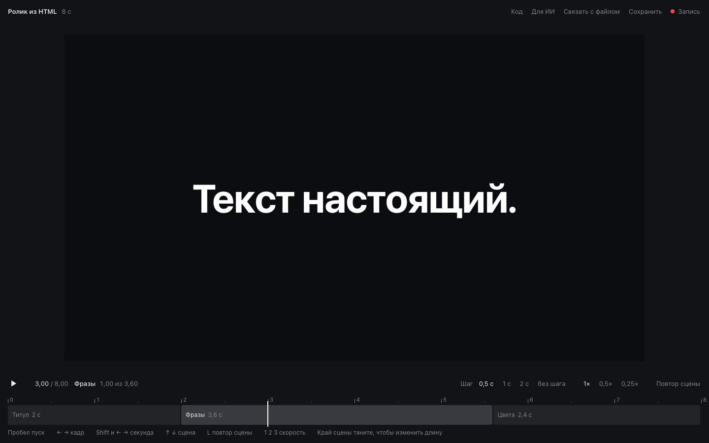

# Ролик из HTML

Пакет, чтобы собрать короткий ролик из HTML с любым ИИ, который пишет код: GigaChat, ChatGPT, Claude. Без After Effects и без установки программ

## Как скачать

Зелёная кнопка «Code» наверху страницы, затем «Download ZIP». Распакуйте архив и откройте `Плеер.html` двойным щелчком, внутри уже стоит пример на три сцены

## С чего начать

Пошагово в [Как пользоваться](Как%20пользоваться.md). Там два пути, через чат и через агента в папке, клавиши плеера и как менять длину сцен

## Что внутри

- [Плеер.html](Плеер.html) таймлайн по сценам, перемотка, повтор сцены, замедление, режим записи
- [Инструкция для ИИ](Инструкция%20для%20ИИ.md) объясняет ИИ, как писать сцены, чтобы они встали в плеер
- [Шаблон промта](Шаблон%20промта.md) поля для вашего ролика
- [Пример сцен](Пример%20сцен.md) так выглядит правильный ответ ИИ
- [Как записать и наложить музыку](Как%20записать%20и%20наложить%20музыку.md) запись экрана на Mac и Windows, музыка
- [Приёмы движения.html](Приёмы%20движения.html) стили, 11 приёмов и 6 принципов анимации вживую, у каждого источник и кнопка «Скопировать для ИИ»
- [Как разобрать референс.html](Как%20разобрать%20референс.html) как замерить чужой ролик и описать движение словами
- [Если что-то не так.html](Если%20что-то%20не%20так.html) что видно в плеере и что написать ИИ

HTML-страницы открываются двойным щелчком после скачивания. Ссылки наверху страниц переключают страницы пакета, проверено в Chrome. На GitHub страницы видны только кодом
